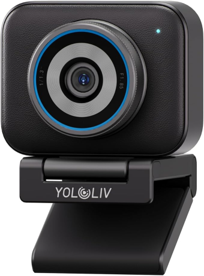

# YoloLiv YoloCam S3: internals and control

The [YoloLiv YoloCam S3](https://www.amazon.com/YOLOLIV-Streaming-DSLR-Like-Cinematic-Uncompressed/dp/B0FQ5NRQ8M/)
is a USB webcam with a Linux computer inside. These notes explain how it
works, how to control it without the vendor's app, and why you should isolate
its USB network connection.

> **Created by an AI agent in collaboration with a human.** The original
> notes were written by Claude, working with the camera's owner during a
> hands-on technical investigation. They are intended as context for other
> agents tasked with analyzing this camera.
>
> **These notes may contain mistakes.** Agents and the humans working with
> them are responsible for verifying the claims against the device, firmware,
> and captured traffic before relying on them.

> **Security warning:** the camera exposes unauthenticated controls and
> root access over its USB network connection. On Linux, put that connection
> in its own [network namespace](network-isolation.md) before experimenting.

## What happens when you plug it in?

- **It appears as a webcam and a network adapter.** Video uses the standard
  USB Video Class (UVC) interface. A separate Ethernet-over-USB interface
  (CDC-NCM, typically named `enx…`) carries the control traffic.
- **The camera assigns the network address.** It runs DHCP and uses
  `192.168.N.10`, where `N` is chosen from 123–130 on first boot and saved in
  U-Boot. To find the camera's address, check the DHCP-assigned IPv4 address
  on your computer's USB network interface and replace the fourth octet with
  `10`. For example, if your computer gets `192.168.124.11`, the camera is at
  **`192.168.124.10`**. No camera shell access is needed.
- **Settings travel over TCP port `12345`.** The vendor's desktop app sends
  framed protobuf messages to this port. The
  [control protocol notes](control-protocol.md) cover framing, sessions,
  heartbeats, and commands.
- **Inside, it's an embedded Linux system.** A HiSilicon Hi3519DV500 runs
  Linux 5.10 with musl and BusyBox.

## Shell and file access

Telnet (port `23`) and FTP (port `21`) both accept **`root` / `yunxi.tv`**.
Telnet gives you a root shell; FTP allows writes across the whole filesystem.
Treat either as full access to the camera, not a limited diagnostic account.

## Security

Treat the camera as an untrusted device:

- **Root access is open by default.** Telnet and writable FTP run as root with
  a fixed, published password (`yunxi.tv`).
- **The firmware has command injection vulnerabilities.** These notes do
  not document the specific injection points.
- **The control port needs no authentication,** and that includes firmware
  upload.
- **Firmware updates are verified by MD5 only,** with no signature.
- **Everything runs as root,** including the large closed-source C++ app that
  parses everything sent to the control port.

Keep the camera's network interface separate from your normal host network.
The [network isolation guide](network-isolation.md) explains how to do that
on Linux, including automatic setup with udev and systemd.

## Where to go next

| If you want to… | Read |
|---|---|
| Isolate the camera's network connection | [Network isolation](network-isolation.md) — Linux network namespaces and automatic setup |
| Build your own controls | [Control protocol](control-protocol.md) — TCP framing, message schema, sessions, captured frames, and command IDs |
| Identify the hardware and services | [Hardware and software](hardware-and-software.md) — processor, memory, sensor, USB formats, OS, apps, and open ports |
| Understand storage or firmware updates | [Storage and firmware](storage-and-firmware.md) — A/B partitions, boot slots, settings, archive format, and updater behavior |
| Explore how images are processed | [Image pipeline](image-pipeline.md) — processing stages, live diagnostics, ISP tuning, timings, and captures |

## Scope and sources

These notes come from a technical investigation of **one camera running
firmware 1.0.4 build 1349**, its release archive
(`YunxiCamera-ch131b-20260831-1.0.4.tar.gz`), and earlier work investigating
the control protocol. Other units or firmware versions may differ; verify
before relying on these details.
